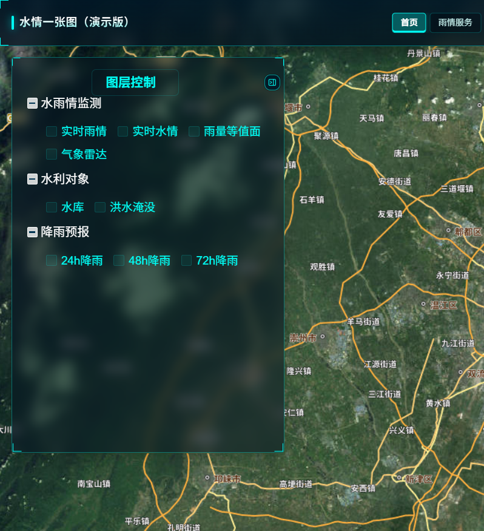
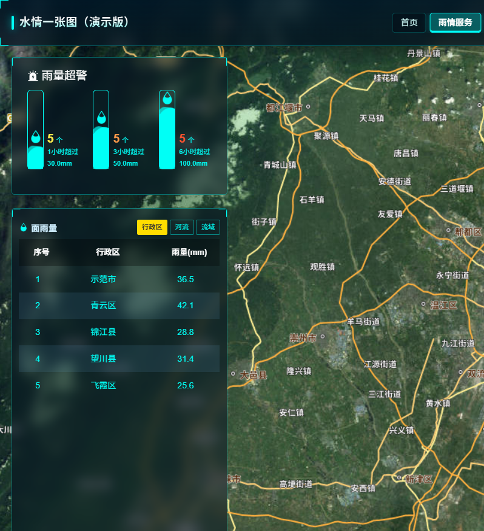
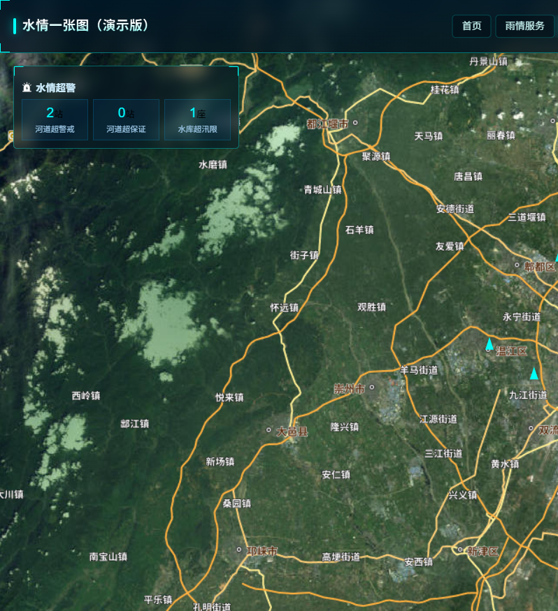
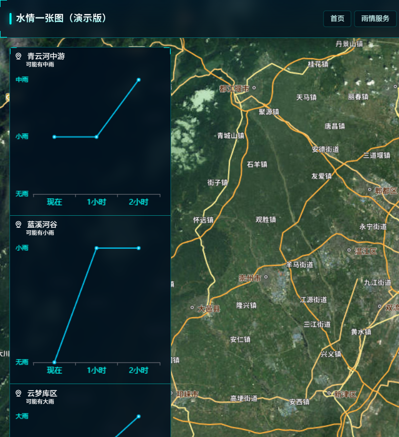
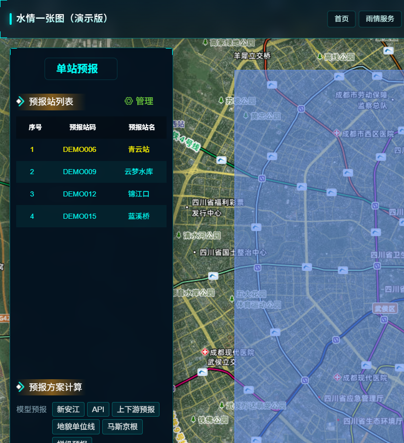
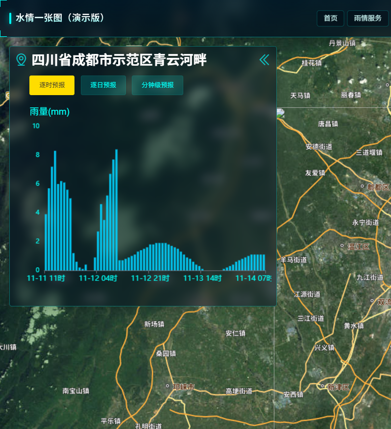

# 水情一张图（HydroBoard UI 演示版）

面向水利水情业务的大屏前端开源演示项目。基于 **Vue 2 + Vite + Leaflet + ECharts + Element UI**，内置 Mock 数据，**无需后端即可独立运行**。

> 演示 / 学习用途：已去除 OAuth、权限校验与真实项目接口，测站与水雨情均为虚构数据。



## 功能清单

### 一张图首页
- [x] 国内底图切换（天地图影像 / 矢量、高德地图 / 影像、智图深蓝）
- [x] 图层控制树（水雨情监测、水利对象、降雨预报）
- [x] 实时雨情 / 实时水情图层开关
- [x] 雨量等值面、气象雷达图层入口
- [x] 水库对象与洪水淹没专题（图层控制内）
- [x] 24h / 48h / 72h 降雨预报图层入口
- [x] 测量工具、经纬网、图例
- [x] 测站弹窗（基础信息、水位流量过程等演示）

### 雨情服务
- [x] 雨量超警统计（1h / 3h / 6h）
- [x] 面雨量（行政区 / 河流 / 流域）
- [x] 实时雨情站点列表与时段筛选
- [x] 雨量等级图例（小雨～特大暴雨）



### 水情服务
- [x] 水情超警（河道超警戒 / 超保证、水库超汛限）
- [x] 实时水情列表（水文 / 水位 / 水库 / 山洪分栏）
- [x] 涨落态势图例与站点筛选



### 预警预报
- [x] 分区降雨预测卡片（短临趋势演示）
- [x] 图层快捷入口（预警 / 云图 / 雷达 / 降雨）



### 单站预报
- [x] 预报站列表与对象管理入口
- [x] 模型方案计算入口：新安江、API、上下游、马斯京根、梯级预报
- [x] 站码 / 站名 / 集水面积等基础信息展示



### 综合服务
- [x] 点选位置降雨过程（逐时 / 逐日 / 分钟级）
- [x] 降雨等值面与时长切换（24h～240h）
- [x] 预报降雨 / 分钟级降雨切换



## 技术栈

- **框架**：Vue 2.7、Vue Router、Vuex
- **构建**：Vite 5
- **UI**：Element UI
- **地图**：Leaflet（默认天地图影像，可切换高德 / 智图等国内图源）
- **图表**：ECharts
- **请求**：Axios（`src/mock` 拦截并返回模拟数据）
- **其他**：Turf、dayjs、Sass

## 覆盖的水利行业业务

1. **水雨情监测** — 雨量站、水位站、水文站、水库站等多站类展示；时段累计雨量与等级划分。
2. **超警研判** — 雨量超阈值、河道超警戒 / 超保证、水库超汛限等统计与列表。
3. **水库与河道水情** — 水位、流量、库容等过程线与最新值展示（演示数据）。
4. **预报预警入口** — 短临降雨、雷达、综合预报、单站模型方案等业务入口。
5. **一张图图层管理** — 图层树开关、图例、国内底图切换，适合防汛会商大屏。
6. **洪水相关专题** — 洪水淹没等专题入口，便于二次对接水动力成果。

## 快速开始

### 环境要求

- Node.js `>= 18`（推荐 18 / 20 LTS）
- npm `>= 9`

### 安装与运行

```bash
cd hydroboard-ui
npm install --legacy-peer-deps
npm run dev
```

浏览器打开：`http://localhost:5172/`

### 打包

```bash
npm run build
npm run preview
```

### Mock 说明

- 默认开启：`VITE_USE_MOCK=true`（见 `.env.development` / `.env.production`）
- 核心代码：`src/mock/`
  - `handlers.js`：按 URL 匹配返回模拟响应
  - `data/portal.js`：菜单、标题、底图、字典
  - `data/stations.js`：虚构测站与水雨情序列
- 关闭 Mock：将环境变量设为 `VITE_USE_MOCK=false`（需自行提供后端）

## 目录结构（节选）

```text
hydroboard-ui/
├── docs/screenshots/     # 界面截图
├── public/               # 静态资源
├── src/
│   ├── api/              # 接口定义（演示版由 Mock 承接）
│   ├── components/       # 地图、面板、弹窗等
│   ├── mock/             # 前端 Mock
│   ├── pages/            # 业务页面
│   ├── router/           # 路由（无登录拦截）
│   └── store/            # Vuex
├── package.json
└── vite.config.js
```

## 开源说明

- License：MIT（见 `LICENSE`）
- npm 包名：`hydroboard-ui`
- 演示数据与站名为虚构，请勿当作真实测报成果使用
- 已移除：OAuth/SSO、角色权限过滤、内网地址与真实密钥
- 地图默认使用天地图等国内公开瓦片；生产环境请替换为自己的合规密钥与图源

## 水利信息化兼职 / 合作

本人长期从事水利信息化前端与业务落地，熟悉：

- 水雨情监测一张图、防汛会商大屏
- 水库 / 河道水情、超警统计分析
- Leaflet / 天地图 / GeoServer 图层集成经验
- Vue 2/3 水利业务系统交付与问题排查

可承接：界面二次开发、大屏定制、地图图层对接、开源演示改造、远程兼职等。

**联系邮箱：[15091153@qq.com](mailto:15091153@qq.com)**

欢迎通过 Issue / Email 沟通需求。

---

如果这个项目对你有帮助，欢迎 Star。
